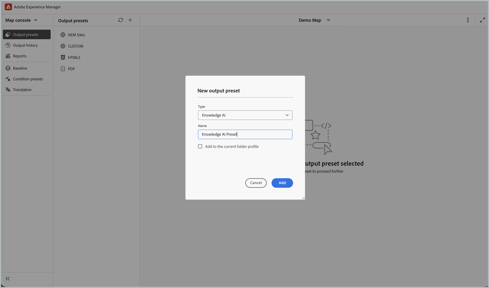

# 使用Guides Knowledge AI (Beta)連結Adobe Experience Manager Guides

>[!IMPORTANT]
>
> 此功能預設為停用。 若要啟用Guides Knowledge AI功能，請聯絡您的客戶成功團隊。

本文為管理員和內容工程師提供端對端流程，以便設定Guides Knowledge AI存取權並上傳Experience Manager Guides內容供Knowledge AI內使用。

## 程式概述

| 步驟 | 您將要執行的動作 |
|---|---|
| 1 | 在Adobe Developer Console中建立服務帳戶，並根據您的環境進行設定。 |
| 2 | 從服務帳戶認證檔案擷取技術帳戶電子郵件。 |
| 3 | 透過建立角色並新增使用者，授予Knowledge AI中的服務帳戶存取權。 |
| 4 | 在Experience Manager Guides中設定Knowledge AI輸出預設集並上傳內容。 |


## 先決條件

開始之前，請確定您擁有下列存取權和許可權：

| 需求 | 用途 |
|---|---|
| Adobe Developer Console | 建立服務帳戶並下載其JSON認證。 |
| Adobe Experience Manager Guides | 編寫內容並設定Knowledge AI的輸出預設集。 |
| [知識AI](https://guidesai.adobe.io/) | 管理角色和使用者，並接收上傳的內容。 |
| 許可權：建立服務帳戶 | 在Adobe Developer Console中需要建立服務帳戶。 |
| 許可權：在Knowledge AI中管理使用者和角色 | 在Knowledge AI中授與服務帳戶存取權的必要專案。 |

## 建立服務帳戶

Knowledge AI會使用服務帳戶來安全地驗證及存取內容。

1. 遵循[設定Microservices IMT組態](https://experienceleague.adobe.com/en/docs/experience-manager-guides/using/knowledge-base/kb-articles/publishing/configure-microservices-imt-config)中的指示

1. 建立新的服務帳戶並下載產生的JSON憑證檔案。

1. 使用下載的認證來設定必要的環境設定。

完成後，服務帳戶應該會成功與您的環境建立關聯。

>[!NOTE]
>
> 如果您已經為您的環境建立並設定了服務帳戶，您可以繼續進行下一個步驟。


## 擷取技術帳戶電子郵件

若要授予Knowledge AI的存取權，請識別服務帳戶。

1. 開啟下載的服務帳戶JSON檔案。
1. 搜尋欄位名稱`technical_account_email`。

檢視類似下列的值：

```json
{
"technical_account_email": "a1b2c3d4e5f6@techacct.adobe.com"
}
```

1. 複製與`technical_account_email`關聯的電子郵件地址。 您將在下一個步驟中使用此電子郵件地址。

## 授予Knowledge AI中的存取權

若要允許服務帳戶管理和上傳內容，請將其新增至具有適當許可權的Knowledge AI。

1. 開啟[知識AI](https://guidesai.adobe.io/)。
1. 瀏覽至&#x200B;**安全性>角色**，並建立具有最低必要許可權的角色。
1. 瀏覽至&#x200B;**安全性>使用者>新增使用者**。 使用從服務帳戶JSON複製的`technical_account_email`新增使用者、從&#x200B;**網域**&#x200B;下拉式清單中選取網域，並指派在上一步中建立的角色。

服務帳戶現在已獲授權執行內容管理和上傳作業。

## 設定Knowledge AI預設集並上傳內容

若要將內容發佈至Knowledge AI，請在設定許可權後設定Experience Manager Guides。

1. 在Experience Manager Guides中開啟&#x200B;**地圖主控台**。
1. 瀏覽至&#x200B;**輸出預設集**&#x200B;索引標籤。
1. 選取+圖示以建立輸出預設集。
1. 從&#x200B;**新增輸出預設集**&#x200B;對話方塊的&#x200B;**型別**&#x200B;下拉式清單中選取&#x200B;**知識AI**。 輸入&#x200B;**名稱**&#x200B;並選取&#x200B;**新增至目前的資料夾設定檔**，以在目前的資料夾設定檔中建立輸出預設集。

   

1. 選取「**新增**」。 會建立Knowledge AI預設集。
1. 開啟已設定的Knowledge AI預設集。
1. 選取角色被授與`technical_account_email`的網域，然後選取&#x200B;**上傳內容**。 這會觸發將內容上傳工作流程上傳至Knowledge AI。 等候上傳程式完成。

   

1. 上傳完成後，請選取&#x200B;**在知識AI中開啟**。 這會使用上傳的內容在網域中開啟Knowledge AI聊天。

   

您已成功設定服務帳戶、指派所需許可權，並在Knowledge AI中提供Experience Manager Guides內容。 每當您想要發佈更新的內容時，請建立新的Knowledge AI預設集，並遵循上文[設定Knowledge AI預設集及上傳您的內容](#configure-knowledge-ai-preset-and-upload-content)一節中概述的步驟。


