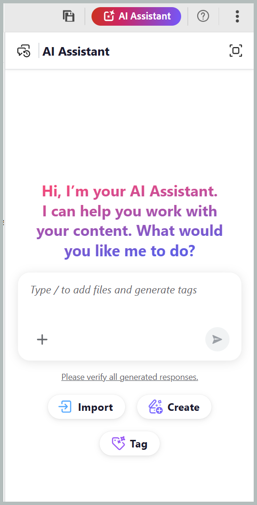

# 使用AI助理進行智慧標籤

透過Adobe CX Enterprise Coworker在AI Assistant的代理程式模式中提供的智慧型標籤技能，可讓您更快、更輕鬆且更一致地標籤您的內容。 它會分析您的內容，並根據您組織的分類法建議相關標籤，消除手動檢閱內容並識別適用標籤的必要。 您的管理員可以選取您工作區的相關名稱空間，透過[Workspace設定](../install-conf-guide/workspace-settings.md#general)設定用於產生標籤建議的分類法。

您可以檢閱建議的標籤，然後在確認選取之前，選擇套用或拒絕這些標籤，以維持控制能力。 這能減少手動操作、改善標籤準確性，並有助於在檔案中維持一致的中繼資料。

## 使用智慧標籤技能將標籤套用至單一或多個主題

執行以下步驟，使用AI Assistant以智慧標籤技能將標籤套用至單一或多個主題：

1. 登入Experience Manager Guides。
1. 在首頁上，從導覽列選取&#x200B;**AI小幫手**。 請確定管理員已啟用代理模式[&#128279;](../install-conf-guide/workspace-settings.md)中的AI小幫手。
1. 使用下列其中一種方法，新增您要為其產生標籤建議的主題：

   - **使用建議的提示**：對於回應區域中的第一個聊天，請選取&#x200B;**檔案提示的建議標籤**。 提示會自動新增至提示空間。 選取`[file]`，然後從&#x200B;**選取檔案**&#x200B;對話方塊中的儲存庫或集合中選擇主題。 您可以從&#x200B;**選取檔案**&#x200B;對話方塊中選取一個主題。

     {width="650"}

   - **使用捷徑**：在提示欄位中輸入`/`，然後選擇&#x200B;**新增存放庫參考**&#x200B;以從存放庫選擇主題（或&#x200B;**從裝置新增檔案**&#x200B;以從您的電腦上傳主題），然後輸入提示，例如&#x200B;*建議檔案標籤*。

   - **拖放**：將單一主題或多個主題拖放至提示空間，然後輸入提示，例如&#x200B;*檔案的建議標籤*。

     {width="650"}

   - **指定主題路徑**：針對相同或不同對映的多個主題，輸入`@`後跟逗號分隔的路徑，並輸入提示，例如&#x200B;*檔案的建議標籤*。

     {width="650"}

1. 選取&#x200B;**傳送**。

1. AI Assistant會分析主題內容並產生標籤建議。

   {width="650"}

1. 檢閱建議的標籤，如下所示：

   >[!NOTE]
   >
   > 對於已包含標籤的主題，「AI助理」會顯示現有的標籤。 這些標籤是唯讀的，無法修改或移除。

   - 對於單一主題，您可以&#x200B;**接受**&#x200B;要套用的建議，或者&#x200B;**拒絕**&#x200B;不需要的建議。

     分析內容後{width="650"}

   - 若為多個主題：
     1. 選取&#x200B;**預覽**&#x200B;以檢閱AI產生的標籤建議。

        {width="650"}

     1. 檢閱每個主題的建議標籤，然後選擇下列其中一個動作：
        - **全部接受**&#x200B;以套用所有主題的所有建議標籤。
        - **拒絕所有**&#x200B;以捨棄所有主題的所有建議標籤。
        - **清除所有建議**&#x200B;以移除特定主題的所有建議標籤。
        - 選取標籤旁的&#x200B;**X**&#x200B;圖示，移除個別標籤建議。

          {width="650"}

1. 當您接受建議的標籤時，「智慧型標籤」技能會將AI產生的標籤新增至已套用至內容的標籤。

完成複查後，「AI輔助程式」會顯示套用至主題的標籤摘要，以及任何拒絕的標籤建議。

{width="650"}

## 使用智慧標籤技能將標籤套用到地圖的多個主題

執行以下步驟，使用AI助理以智慧標籤技能將標籤套用到地圖的多個主題：

1. 登入Experience Manager Guides。
1. 在首頁上，從導覽列選取&#x200B;**AI小幫手**。 請確定管理員已啟用代理模式的AI助理。
1. 使用下列任一方法新增您要為其產生標籤建議的地圖（如主題中所述）：

   - **使用建議的提示**：對於回應區域中的第一個聊天，請選取&#x200B;**檔案提示的建議標籤**。 提示會自動新增至提示空間。 選取`[file]`，然後從&#x200B;**選取檔案**&#x200B;對話方塊中的存放庫或集合中選擇對應。

   - **拖放**：將地圖拖放至提示空間，然後輸入提示，例如&#x200B;*檔案的建議標籤*。

   - **使用捷徑**：在提示欄位中輸入`/`，然後選擇&#x200B;**新增存放庫參考**&#x200B;以從存放庫選擇對應（或&#x200B;**從裝置新增檔案**&#x200B;以從您的電腦上傳對應），然後輸入提示，例如&#x200B;*建議檔案標籤*。

     {width="650"}

1. 選取&#x200B;**傳送**。
訊息會指出選取的地圖包含多個主題。 選取&#x200B;**選取主題**&#x200B;以選擇要標籤建議的主題。

   {width="650"}

1. 在&#x200B;**選取主題**&#x200B;對話方塊中，選取您要標籤建議的主題。\
   **選取主題**&#x200B;對話方塊提供下列內容：

   - **主題清單：**&#x200B;顯示所選地圖中的所有主題。 選取您要為其產生標籤建議的主題。
   - **預覽窗格：**&#x200B;顯示所選主題及其現有標籤的預覽。
   - **篩選器：**&#x200B;篩選主題以僅顯示已新增&#x200B;**個標籤**&#x200B;或未新增標籤&#x200B;**的主題**。

     {width="650"}

1. 選取&#x200B;**確認**。 AI Assistant會分析所選的主題，並顯示為每個主題產生的標籤建議數量。
1. 選取&#x200B;**預覽**&#x200B;以檢閱AI產生的標籤建議。
1. 檢閱每個主題的建議標籤，然後選擇下列其中一個動作：
   - **接受**&#x200B;以套用所有主題的所有建議標籤。
   - **拒絕**&#x200B;以捨棄所有主題的所有建議標籤。
   - **清除所有建議**&#x200B;以移除特定主題的所有建議標籤。
   - 選取標籤旁的&#x200B;**X**&#x200B;圖示，移除個別標籤建議。

     >[!NOTE]
     >
     > 對於已包含標籤的主題，「AI助理」會顯示現有的標籤。 這些標籤是唯讀的，無法修改或移除。

   {width="650"}

1. 當您接受建議的標籤時，智慧標籤技能會將AI產生的標籤新增到已套用至內容的標籤中。

完成複查後，「AI輔助程式」會顯示套用至每個主題的標籤摘要，以及任何拒絕的標籤建議。

