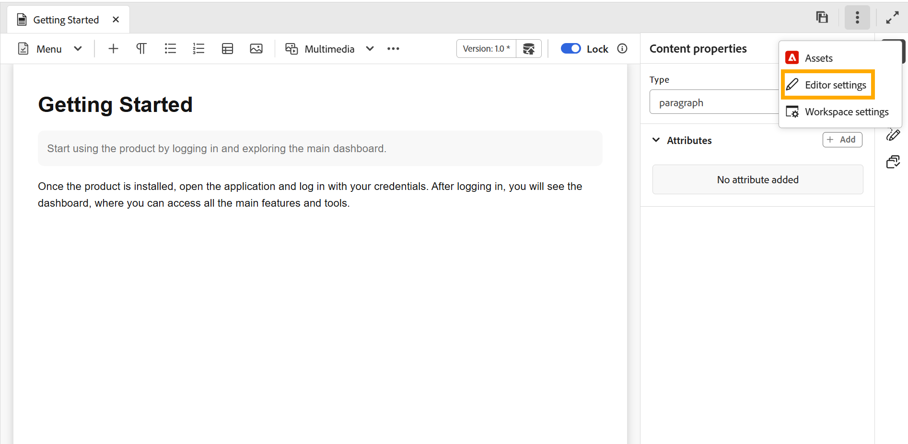
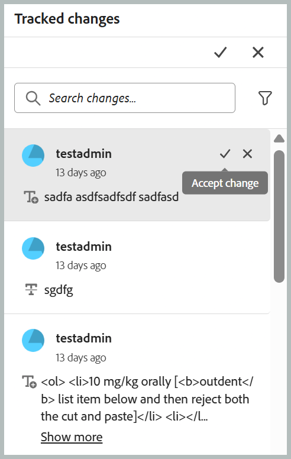

# 編輯器設定

>[!NOTE]
>
> 本文僅適用於新編輯器。 若要在您的環境中啟用此功能，請聯絡AEM Guides客戶成功團隊。

編輯器設定提供集中式設定面板，可讓您在個別作者層級自訂編輯器行為。 在編寫過程中提供更大的彈性、一致性和控制能力。

此集中式設定面板可讓您從單一位置管理重要編輯器偏好設定，減少分散或手動設定的需求。 您可以從標籤列上的&#x200B;**更多動作**&#x200B;存取編輯器設定。

{width="650"}

## 支援的組態選項

編輯器設定可讓您根據自己的偏好自訂各種選項，包括追蹤變更、顯示標籤、快速插入功能表等等。

{width="350"}

### 追蹤變更

>[!NOTE]
>
>- 此功能預設為啟用，若要停用，請聯絡AEM Guides客戶成功團隊。
>- 使用表格時，會追蹤列或欄的插入，但不會在「追蹤變更」面板中追蹤列或欄的刪除。

啟用&#x200B;**追蹤變更**&#x200B;模式，以記錄對主題所做的編輯。 啟用後，系統會在您工作時擷取每次的插入與刪除，而且所有變更都會列在&#x200B;**追蹤變更**&#x200B;面板中。 在相同位置所做的連續編輯會被分組，並顯示在&#x200B;**追蹤變更**&#x200B;面板中，顯示為單一變更。

刪除的內容會以刪除線顯示，而插入的內容會以綠色文字顯示。 此外，變更列會沿著主題頁面的邊緣顯示，紅色列表示已刪除的內容，綠色列表示新增的內容。 如果線條同時包含新增和刪除專案，則會同時顯示兩個變更列。

當多個使用者處理相同主題時，追蹤變更可讓他們檢視彼此的編輯。 一旦內容準備好完成，使用者可以檢閱追蹤的變更並接受或拒絕它們。

{width="350"}

**顯示內嵌的追蹤刪除**

控制追蹤變更開啟時已刪除內容在編輯器中的顯示方式。 啟用時，刪除的內容會保持其原始位置的內嵌可見狀態，做為刪除線文字。 停用時，系統不會顯示刪除的內容。 相反地，鉛筆圖示會出現在內容移除的位置，讓您更清楚瞭解主題。 選取鉛筆圖示，即可移至「追蹤的變更」面板中對應的已刪除內容。

{width="350"}

**接受或拒絕追蹤的變更**

若要檢閱變更，請選取右側面板中的&#x200B;**追蹤變更**&#x200B;圖示以開啟追蹤變更面板，然後執行下列步驟：

1. 在面板中選取追蹤的變更。 已變更的內容會在檔案中選取。
1. 選取&#x200B;**接受變更**&#x200B;圖示以接受變更，或選取&#x200B;**拒絕變更**&#x200B;圖示以拒絕變更。

   {width="650"}

1. 若要按一下即可接受或拒絕所有變更，請從面板頂端選取&#x200B;**接受所有變更**&#x200B;或&#x200B;**拒絕所有變更**。

   {width="650"}

### 不分行空格

啟用此選項可在編輯器中編輯時顯示不間斷空格的指示器。 它僅在DITA主題和DITA map的作者檢視中可見。

### XML註解

讓作者直接在「作者」模式中檢視、編輯和插入XML註解，以便在內容中更清楚顯示。 啟用後，作者可以在「作者」模式本身的內容中直接檢視、插入、編輯及刪除XML註解，更輕鬆為共同作業人員新增內容相關註解。 停用時，XML註解會隱藏在「作者」模式中，且無法從「作者」模式插入或修改，以確保不需要註解的使用者獲得更簡潔的撰寫體驗。 您可以使用`<!-- test comment -->`語法，繼續在來源模式中檢視及編寫XML註解。

>[!NOTE]
>
> 對於XML註解，**追蹤變更**&#x200B;只記錄整個註解的插入或刪除。 在現有XML註解中所做的編輯將不會被記錄。

{width="650"}

### 標記

控制標籤在編輯器中的可見性。 啟用後，結構標籤會顯示在內容中，讓作者檢視及管理基礎DITA結構。 停用後，這些標籤會隱藏，以提供更乾淨、更聚焦的撰寫體驗。

{width="650"}

啟用&#x200B;**顯示標籤**&#x200B;設定時，您也可以啟用&#x200B;**顯示屬性**，以檢視及驗證與專案相關的屬性。 當元素具有三個以上關聯的屬性時，計數指示器就會出現。 將滑鼠指標暫留在該指標上，會顯示套用至該元素的完整屬性清單。

    ！[設定具有屬性的標籤](./images/config-tags-attributes.png) {width=&quot;650&quot;}

### 編輯器中的快速插入選單

啟用直接新增元素，同時以製作模式編輯時直接新增元素於游標位置，而不需導覽至工具列。 也可以在&#x200B;**我的最愛**&#x200B;中設定常用元素，以便更快速地存取。 當您在Windows上按&#x200B;**Control + /**&#x200B;或在macOS上按游標位置上的&#x200B;**Command + /**&#x200B;時，可以直接在編輯器中使用快速插入功能表。

{width="650"}

您可以搜尋元素並將其新增至您的最愛，移除任何先前新增的元素，以及使用簡單的拖放方式來重新排列元素。 我的最愛包含您最常用的元素，當您從編輯器存取時，您在此設定的順序會反映在「快速插入」功能表中。

以下是有關如何在新編輯器中使用快速插入功能表的短片。

>[!VIDEO](https://video.tv.adobe.com/v/3491343)

