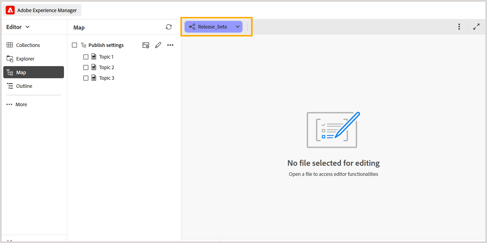
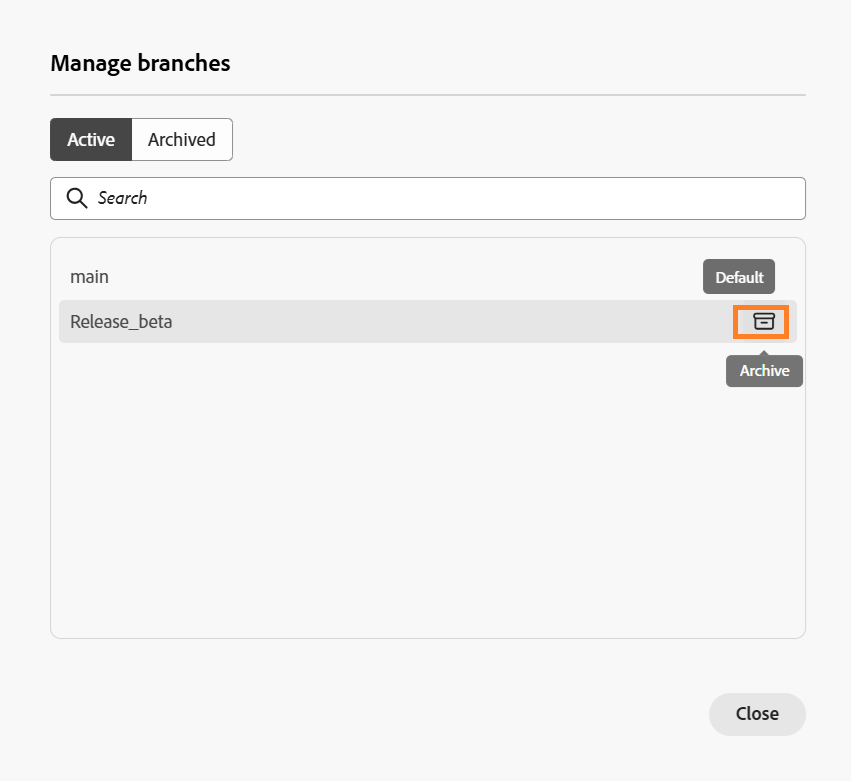

# 建立和管理DITA map的分支

在Experience Manager Guides中，您可以建立DITA map的多個分支，以管理不同版本、功能或修正的檔案。 您可以在分支之間切換以處理關聯的內容、封存不再需要的分支，並在需要時還原它們。

您也可以從相同DITA map的任何現有分支建立分支。

## 建立分支

您可以建立DITA map的分支來處理檔案變更，而不會影響其他分支中的對應內容。

執行以下步驟來建立分支：

1. 開啟要為其建立分支的DITA map。

   >[!NOTE]
   >
   > 如果編輯器中已開啟另一個對應，則會顯示確認對話方塊。 選取&#x200B;**開啟**&#x200B;以開啟目前分支中選取的地圖。 如需詳細資訊，請檢視[開啟目前地圖內容之外的內容](#open-content-outside-the-current-map-context)。

1. 選取&#x200B;**主要**&#x200B;分支下拉式清單，並確認已選取必要的DITA map。

   

1. 選取&#x200B;**新增分支**&#x200B;以建立所選地圖的分支。

1. 在&#x200B;**新分支**&#x200B;對話方塊中，輸入新分支的名稱，並選取要從中建立分支的父分支。

   

1. 選取「**建立**」。

系統會為選取的DITA map建立新分支。 您現在可以切換到新分支並開始處理其關聯內容。

## 在分支之間切換

執行以下步驟來切換分支：

1. 選取編輯器頂端的&#x200B;**分支下拉式清單** （預設會顯示`main`）。 此時會顯示所選DITA map的可用分支清單。
1. 選取您要使用的分支。

   

   選取的分支隨即開啟，其名稱會出現在編輯器頂端的分支下拉式清單中，取代&#x200B;**main**。

   

您現在可以在選取的分支內處理地圖及其相關內容。

>[!NOTE]
>
>如果在切換分支時主題有未儲存的變更，則會出現一個對話方塊，提示您先儲存變更，然後再切換至所選分支。

您現在可以在選取的分支內處理地圖及其相關內容。

## 分支中的獨立編輯

當您在DITA map的分支中工作時，對其內容所做的變更會保留在所選的分支中，而不會影響其他分支中的對應內容。 這可讓多位作者跨地圖的不同分支，獨立處理相同的主題。

預設會從來源分支或`main`讀取未變更的主題。 在所選分支中編輯主題時，該主題會成為該分支的一部分。 對主題所做的任何後續變更都會保留在所選分支內。

您可以在相同DITA map的分支之間切換，以檢視和編輯其各自的內容。

### 編輯分支中的主題

您可以在所選分支中編輯與DITA map相關的主題，而不會影響它們在其他分支中的內容。

執行以下步驟來編輯主題：

1. 在編輯器中開啟DITA map。
2. 從分支下拉式清單中，選取您要在其中編輯主題的分支。
3. 從地圖開啟您要修改的主題。
4. 對主題進行必要的變更。
5. 儲存您的變更。

   已修改主題的副本會儲存在所選分支中。 其他分支中的對應主題保持不變。

您可以繼續編輯所選分支中的主題，或切換到另一個分支以處理其內容。

### 開啟目前地圖內容外部的地圖

在Experience Manager Guides中，**map內容**&#x200B;參考編輯器中目前開啟的DITA map。

如果您嘗試開啟的地圖、主題或資產不屬於目前的地圖前後關聯，則會出現確認對話方塊，其中包含下列選項：

- **開啟：**&#x200B;以選取的內容取代目前的地圖內容。
- **在編輯器中開啟：**&#x200B;在新的索引標籤中開啟內容而不變更目前的對映內容。
- **取消：**&#x200B;取消作業並保留目前的地圖內容。

例如，假設目前在&#x200B;**主要**&#x200B;分支中選取`master_map.ditamap`。

如果您嘗試開啟另一個DITA map，會出現下列確認對話方塊：

選取&#x200B;**開啟**&#x200B;以切換至選取的對應。

`main`分支的對應內容已更新為新選取的對應，可讓您處理其關聯內容。

### 開啟或編輯目前地圖內容以外的主題

結構圖未參考的主題不會自動在分支中使用。

選取&#x200B;**在目前分支中編輯**，讓這些主題可在選取的分支中編輯。

您現在可以編輯主題，而不影響其在`main`中的內容。 不過，此主題不會自動新增至相關聯的DITA map，也不會包含在已發佈的輸出中。 若要在輸出中包含主題，請將其新增至DITA map。

## 管理分支

您可以從Map主控台的&#x200B;**分支**&#x200B;面板管理DITA map的分支。 您可以檢視可用的分支、建立新分支、合併或重新命名現有分支，以及封存不再主動使用的分支。

**分支**&#x200B;面板會列出所選DITA map的所有可用分支。

若要管理分支，請將游標停留在所需分支上，然後選取&#x200B;**選項**&#x200B;功能表。 下列動作可供使用：

- **新分支：**&#x200B;從選取的分支建立新分支。
- **合併至主要：** [將所選分支的變更](./merge-branches.md)合併至`main`分支。
- **重新命名分支：**&#x200B;變更所選分支的名稱。
- **合併歷史記錄：**&#x200B;顯示合併活動的歷史記錄。 此選項僅在建立合併請求後可用。
- **封存分支：**&#x200B;封存不再使用的分支。

  >[!NOTE]
  >
  > Experience Manager Guides不支援刪除分支。 您可以封存不再主動使用的分支。

您也可以使用&#x200B;**分支**&#x200B;面板頂端的選項來搜尋分支、重新整理分支清單或建立新分支。

### 封存分支

您可以封存不再主動使用的DITA map分支，並在需要時還原它們。

>[!NOTE]
>
> 無法封存預設分支(`main`)。

若要封存分支，請執行以下步驟：

1. 在&#x200B;**分支**&#x200B;面板中，選取&#x200B;**管理**&#x200B;圖示。

   

   顯示&#x200B;**管理分支**&#x200B;對話方塊。

   

   此對話方塊包含以下標籤：

   - **作用中：**&#x200B;列出所選DITA map的所有作用中分支。
   - **已封存：**&#x200B;列出所選DITA map的所有已封存分支。

2. 在&#x200B;**作用中**&#x200B;索引標籤中，將游標停留在您要封存的分支上，並選取&#x200B;**封存**。

   

   選取的分支已封存並移動到&#x200B;**已封存**&#x200B;索引標籤。

### 還原已封存的分支

當您需要繼續處理DITA map的內容時，可以恢復其已封存的分支。

若要還原已封存的分支，請執行以下步驟：

1. 在&#x200B;**分支**&#x200B;面板中，選取&#x200B;**管理**&#x200B;圖示。
2. 在&#x200B;**管理分支**&#x200B;對話方塊中，選取&#x200B;**已封存**&#x200B;索引標籤。
3. 找到您要還原的分支，並選取&#x200B;**還原**。

   分支已還原並出現在&#x200B;**作用中**&#x200B;索引標籤中。

