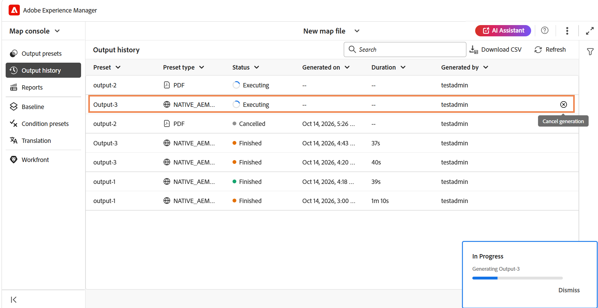
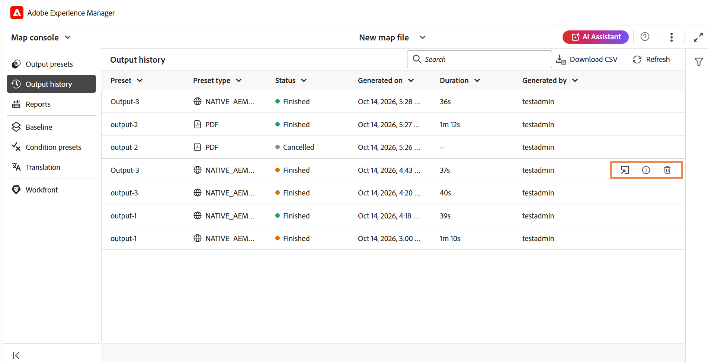
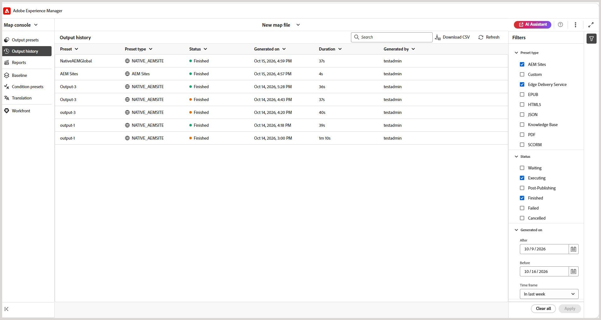
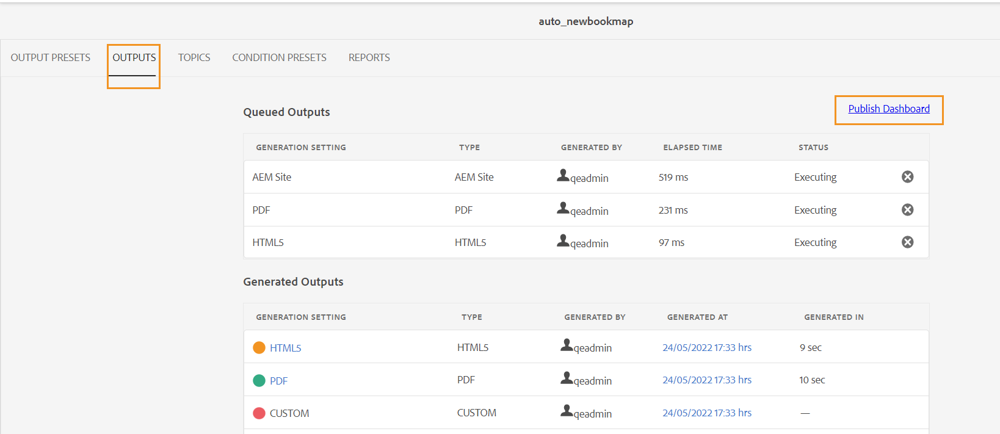
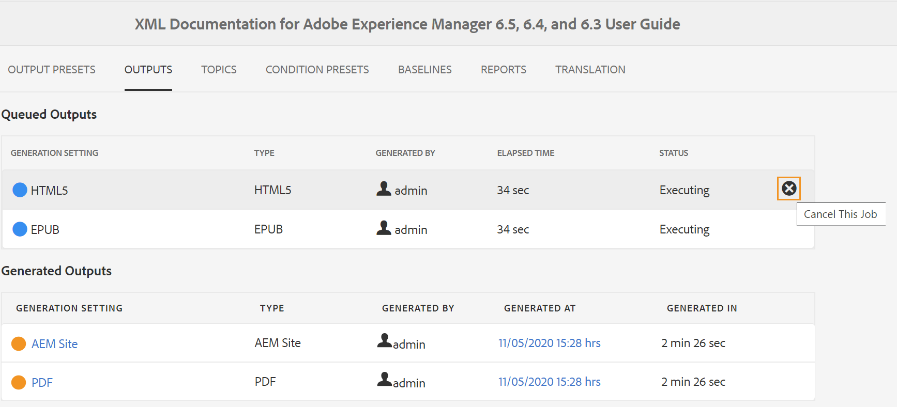
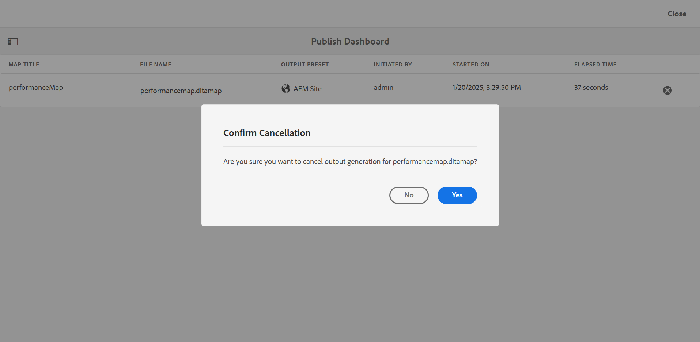
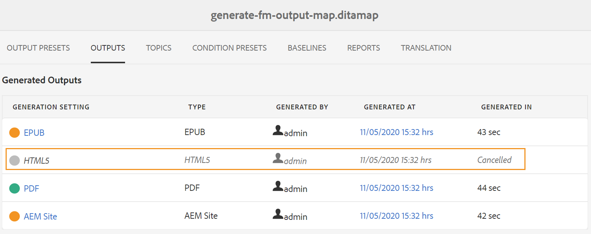
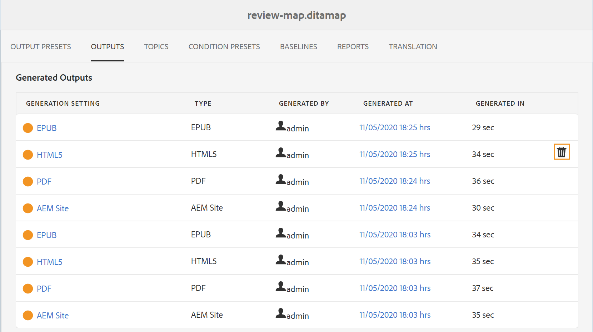

# 管理輸出產生程式

Adobe Experience Manager Guides可讓您監視和管理DITA map的輸出產生任務。 您可以檢視輸出產生作業的狀態、取消進行中的作業，以及從輸出產生歷史記錄中移除過時的專案。

當您為地圖起始輸出產生任務或重新產生所選主題後，Experience Manager Guides會將該任務傳送至輸出產生佇列。 工作狀態會隨著輸出產生程式的進行而更新。

您可以使用編輯器中的&#x200B;**輸出歷史記錄**&#x200B;索引標籤或Assets UI中的&#x200B;**輸出**&#x200B;索引標籤，檢視及管理輸出產生工作。

## 從編輯器檢視及管理輸出產生工作

您可以直接從Map主控台的&#x200B;**輸出歷程記錄**&#x200B;索引標籤檢視和管理輸出產生工作。

在Map主控台中開啟DITA map，並使用Experience Manager Guides中任何可用的輸出預設集來產生輸出。 切換至&#x200B;**輸出歷程記錄**&#x200B;標籤，以檢視輸出產生工作的狀態和其他詳細資訊，如下所示：

對於每個輸出產生作業，您可以檢視下列資訊：

1. **預設集：**&#x200B;用來產生輸出的輸出預設集名稱。
1. **預設型別：**&#x200B;用於產生輸出的輸出預設型別。
1. **狀態：**&#x200B;輸出產生工作的目前狀態，例如「等待中」、「執行中」、「已完成」、「失敗」、「發佈後」或「已取消」。
1. **產生日期：**&#x200B;產生輸出的日期和時間。
1. **持續時間：**&#x200B;產生輸出所花費的時間。
1. **產生者：**&#x200B;起始輸出產生工作的使用者名稱。

>[!NOTE]
>
> 如果輸出產生工作目前正在進行中，**狀態**&#x200B;資料行中的&#x200B;**正在執行**&#x200B;標籤表示工作正在處理中。 使用&#x200B;**重新整理**&#x200B;檢視輸出產生工作的最新狀態。

您也可以取消進行中的輸出產生任務。 若要取消進行中的工作，請將游標停留在工作列上，並選取&#x200B;**取消產生**。

工作取消後，**已取消**&#x200B;標籤會顯示在&#x200B;**狀態**&#x200B;欄中。

對於已完成的輸出產生工作，視工作狀態而定，將滑鼠游標停留在工作列上以存取下列動作：

- **開啟輸出：**&#x200B;在新的索引標籤中檢視產生的輸出。
- **檢視記錄：**&#x200B;存取輸出產生記錄以檢視發佈詳細資料，並疑難排解錯誤或警告。
- **刪除輸出歷程記錄：**&#x200B;從輸出產生歷程記錄中移除選取的工作，但不刪除產生的輸出。

您也可以使用下列選項來處理輸出產生歷史記錄：

- **搜尋：**&#x200B;使用搜尋欄位在記錄中尋找特定的輸出產生工作。
- **下載CSV：**&#x200B;選取「**下載CSV**」即可以CSV格式下載輸出產生歷程記錄。
- **調整資料行大小：**&#x200B;選取資料行名稱旁的下拉式清單，並選取&#x200B;**調整資料行大小**&#x200B;以調整資料行寬度。
- **篩選器**：根據輸出預設集型別、工作狀態以及日期和時間範圍套用篩選器，以縮小輸出產生歷程記錄的範圍。

  

此外，以色彩編碼的圖示會指出每項工作的狀態：綠色代表成功的工作，橘色代表已完成但有訊息的工作，紅色代表失敗的工作。 這可協助您快速找出需要注意的工作。

## 從Assets UI檢視及管理輸出產生工作

您可以使用Assets AI對產生的輸出執行下列動作：

- [檢視輸出產生工作的狀態](#view-the-status-of-the-output-generation-task)
- [取消輸出產生任務](#cancel-an-output-generation-task)
- [刪除輸出任務](#delete-an-output-task)

### 檢視輸出產生工作的狀態

當您為地圖啟動輸出產生任務或重新產生所選主題後，Experience Manager Guides會將此任務傳送到輸出產生佇列。 此佇列會即時更新，顯示佇列中每個輸出產生工作的狀態。

1. 在Assets UI中，導覽至並開啟您要檢查輸出產生狀態的對應檔案。

1. 選取&#x200B;**輸出**。

   

   「輸出」頁面分為兩個部分：

   - **佇列輸出：**

     列出等待產生或正在產生程式中的輸出。 已排入佇列或進行中的工作會在預設集名稱前顯示一個藍色圖示。 您也可以找到用於已排入佇列之任務的輸出產生設定或預設集、型別、啟動任務的使用者、任務已排入佇列後的時間以及目前狀態。

     選取連結以存取&#x200B;**發佈儀表板**&#x200B;並檢視目前執行中的狀態。 發佈儀表板中提供所有作用中發佈任務的清單。 **佇列輸出**&#x200B;和&#x200B;**發佈儀表板**&#x200B;連結只有在輸出正在等待產生或正在產生過程中時才會顯示。 輸出工作完成後，它們不會出現。如需有關發佈儀表板的詳細資訊，請檢視[使用發佈儀表板管理發布工作](generate-output-publish-dashboard.md#)。

   - **產生的輸出**

     列出已完成的輸出工作。 同樣地，這裡顯示的資訊與佇列輸出區段類似，但有一些差異。 您有輸出結果圖示和輸出產生時間形式的新資訊集。

     在此清單中，您可能會有已成功執行的任務、已使用訊息執行的任務或失敗的任務。 成功的工作會以綠色圖示顯示，包含訊息的工作會以橘色圖示顯示，而失敗的工作會以紅色圖示顯示。

     針對所有工作，發佈程式會建立記錄檔\(logs.txt\)，您可以在&#x200B;**產生於**&#x200B;欄中選取連結，以存取該記錄檔。 對於失敗或有訊息的工作，您可以檢查記錄檔，如[檢視一節中所述，並檢查記錄檔](generate-output-basic-troubleshooting.md#id1822G0P0CHS)。

     >[!NOTE]
     >
     > 當您選取所產生PDF輸出的連結時，系統會要求您下載PDF。

### 取消輸出產生任務

Experience Manager Guides可讓發佈者簡單輕鬆地取消任何進行中的發佈工作。 身為發行者，您可以從DITA map主控台或[發佈儀表板](generate-output-publish-dashboard.md#)取消進行中的發佈工作。

執行以下步驟，從DITA map主控台取消輸出產生工作：

1. 在Assets UI中，導覽至並開啟您要取消進行中輸出產生任務的對應檔案。

1. 選取&#x200B;**輸出**。

1. 在&#x200B;**佇列輸出**&#x200B;清單中，將指標暫留在您要取消的工作上。

1. 選取&#x200B;**取消此工作**&#x200B;圖示。

   

1. 在&#x200B;**確認取消**&#x200B;訊息提示上選取&#x200B;**是**。

   

   如果工作尚未開始，則會對工作執行取消命令。 對於正在取消的工作，「狀態」會設為「正在取消」。

   工作成功取消後，就會移至狀態為&#x200B;**已取消**&#x200B;的&#x200B;**產生的輸出**&#x200B;清單。 當您將滑鼠停留在已取消的任務上時，它會顯示已取消任務的使用者名稱。 在下列熒幕擷圖中，*HTML5*&#x200B;工作已取消。

   

### 刪除輸出任務

當您為DITA map產生多個輸出時，在一段時間內，此類map的已產生輸出清單會變得很長。 作為發行者，您可以從&#x200B;*產生的輸出*&#x200B;清單中移除過時的工作，以清除任何對應檔案的輸出歷史記錄。 請注意，不會從系統移除輸出，只會從&#x200B;*產生的輸出*&#x200B;清單移除產生的輸出專案。

執行以下步驟，從「產生的輸出」清單中移除輸出工作：

1. 在Assets UI中，導覽至並開啟您要刪除工作的對應檔案。

1. 選取&#x200B;**輸出**。

1. 在&#x200B;**產生的輸出**&#x200B;清單中，將指標暫留在您要刪除的工作上。

1. 選取刪除圖示。

   

1. 在&#x200B;**確認刪除**&#x200B;訊息提示上選取&#x200B;**是**。

   任務會從「產生的輸出」清單中刪除。

