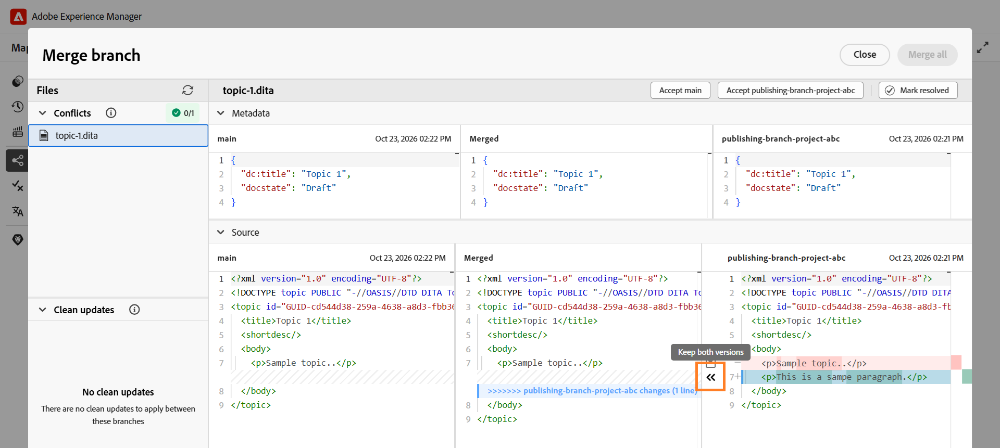

# 將分支合併至主要

在Experience Manager Guides中，您可以將DITA map分支的變更合併至`main`分支。 合併可讓您將已完成的檔案更新合併到`main`中，而不需手動將變更複製到`main`。

例如，假設名為`install-the-lift.ditamap`的DITA map具有名為`Release 2`的分支。 作者可以更新此分支中的安裝指示，而現有檔案在`main`中保持不變。

一旦更新準備就緒，作者就可以將來自`Release 2`的變更合併到`main`中。

## 瞭解分支合併

合併會將DITA map選定分支的變更匯入`main`分支。

- **Source分支：**&#x200B;包含您要合併之變更的分支。
- **目標分支：**&#x200B;變更合併到的預設分支(`main`)。

如果在兩個分支中修改了主題/對映的相同部分，則可能會發生合併衝突，需要解決。

## 合併分支

您可以將DITA map所選分支的變更合併至`main`。

若要合併分支，請執行下列步驟：

1. 在Map主控台中開啟必要的DITA map。
2. 導覽至&#x200B;**分支**&#x200B;標籤。
3. 找到包含您要合併之變更的分支。
4. 開啟分支的&#x200B;**選項**&#x200B;功能表，並選取&#x200B;**合併至主要**。

   

   系統會為所選分支建立合併請求。 它可讓您在合併變更到`main`之前，先檢閱變更並解決任何衝突。

   

5. 選取合併請求。

   合併要求會在&#x200B;**合併分支**&#x200B;檢視中開啟。 如有需要，請檢閱變更並解決任何衝突。
6. 完成合併。

   如有需要，請檢閱變更並解決任何衝突。 如需詳細資訊，請檢視[解決合併衝突](#resolve-merge-conflicts)。

   解決所有衝突後，請選取&#x200B;**全部合併**&#x200B;以將變更合併到`main`中。

   變更會合併至`main`分支。

## 解決合併衝突

在`main`和要合併的分支中修改相同的內容時，會發生合併衝突。 您必須先解決所有衝突，才能將變更合併至`main`。

開啟合併請求時，**合併分支**&#x200B;檢視中會顯示下列區段：

- **衝突：**&#x200B;列出需要衝突解決的檔案。
- **清除更新：**&#x200B;列出可以合併而不解決衝突的檔案。

對於有衝突的檔案，會顯示&#x200B;**合併分支**&#x200B;檢視。

**合併分支**&#x200B;檢視包含下列窗格：

- **左窗格（主要）：**&#x200B;顯示預設分支(`main`)的內容。
- **中間窗格（已合併）：**&#x200B;顯示合併的內容，您可以在此接受分支的變更或直接編輯內容。
- **右側窗格（選取的分支）：**&#x200B;顯示合併至`main`的分支內容。

會根據&#x200B;**已合併**&#x200B;窗格中的內容，在左窗格和右窗格中反白顯示差異：

- **紅色(-)：**&#x200B;表示&#x200B;**已合併**&#x200B;窗格中出現的內容，與對應的左窗格或右窗格中的內容不同。
- **綠色(+)：**&#x200B;表示左窗格或右窗格中存在的、未包含在&#x200B;**已合併**&#x200B;窗格中的內容。

最初，**已合併**&#x200B;窗格包含與`main`相同的內容，因此會在右側窗格中反白顯示差異。 接受所選分支的變更後，左窗格會顯示與更新的&#x200B;**已合併**&#x200B;窗格之間的差異。

執行以下步驟來解決合併衝突：

1. 在&#x200B;**衝突**&#x200B;區段中，選取包含衝突的檔案。

   >[!NOTE]
   >
   > 列在&#x200B;**清除更新**&#x200B;下的檔案只包含所選分支中所做的變更，因此不需要衝突解決。

2. 檢閱&#x200B;**合併分支**&#x200B;檢視中反白的差異，並使用合併控制項解決衝突。

   右窗格中衝突旁的核取方塊會決定如何將選取的分支內容新增至&#x200B;**已合併**&#x200B;窗格：

   - **已選取（預設）：**&#x200B;將&#x200B;**已合併**&#x200B;窗格中的相符內容取代為選取的分支內容。
   - **已清除：**&#x200B;將選取的分支內容與&#x200B;**已合併**&#x200B;窗格中的現有內容一起新增，而不取代它。

   您可以使用下列選項解決衝突：

   - 如果要使用所選分支中的變更，請保持選取衝突的核取方塊，然後選取對應的向左箭號控制項(`<<<`)。 選取的分支內容會取代&#x200B;**已合併**&#x200B;窗格中的衝突內容。

     

   - 如果要保留兩個分支的內容，請清除衝突的核取方塊，然後選取向左箭號控制項(`<<<`)。 這會將選取的分支內容新增至&#x200B;**已合併**&#x200B;窗格，而不取代該窗格中已存在的內容。

     

   - 如果您已接受所選分支的變更，且想要從`main`還原對應的內容，請在左窗格中選取向右的箭頭控制項(`>>>`)。 這會將&#x200B;**已合併**&#x200B;窗格中選取的內容取代為來自`main`的版本。

   >[!TIP]
   >
   > 將滑鼠指標暫留在箭號控制項上，以檢視接受選取的變更將如何影響&#x200B;**已合併**&#x200B;窗格。

3. 檢閱合併內容後，您也可以使用下列其中一個選項來接受任一分支的完整內容：

   - **接受主要：**&#x200B;將選取檔案的&#x200B;**合併**&#x200B;窗格中的內容取代為`main`中的版本。
   - **接受[分支名稱]：**&#x200B;以所選分支的版本取代所選檔案&#x200B;**已合併**&#x200B;窗格中的內容。

   >[!NOTE]
   >
   > 選取任一選項會取代所選檔案之&#x200B;**合併窗格**&#x200B;中的全部內容，包括您在解決衝突時手動所做的任何變更。

   或者，您可以直接在&#x200B;**已合併**&#x200B;窗格中檢閱或編輯內容，並選取&#x200B;**標示已解決**&#x200B;以保留合併的內容。

4. 檢閱&#x200B;**已合併**&#x200B;窗格中的最終內容，並選取&#x200B;**標示已解決**&#x200B;以將檔案標示為已解決。

5. 對&#x200B;**衝突**&#x200B;下列出的所有檔案重複這些步驟。

   解決所有衝突後，**全部合併**&#x200B;選項就會變為可用。

6. 選取&#x200B;**全部合併**，將已解析的檔案和清除的更新合併到`main`中。

   >[!NOTE]
   > 
   > 在解決所有衝突之前，**全部合併**&#x200B;選項會保持停用狀態。

   已解析的變更會合併至`main`。 無法復原已完成的合併。 不過，您可以建立新的合併請求，將後續變更合併至主要內容。

## 管理合併請求

您可以使用內容功能表管理現有的合併請求。

若要管理合併請求，請開啟其內容功能表，並選取下列其中一個選項：

- **預覽：**&#x200B;顯示合併要求中的變更，但不合併它們。
- **檢視記錄：**&#x200B;檢視與合併要求關聯的記錄。
- **刪除：**&#x200B;刪除合併要求。 分支及其變更不受影響。
- **檢視報告：**&#x200B;分支合併到`main`後檢視合併報告。