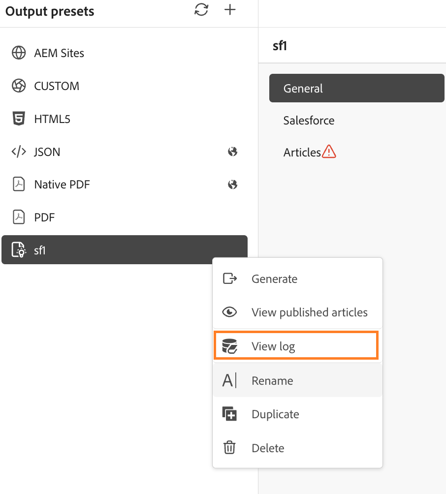

# 產生知識庫輸出 {#id218CL05J0M1}

Adobe Experience Manager Guides隨附以文章為基礎的發佈功能，可讓使用者同時發佈一或多篇知識庫文章。

此引擎也隨附OOTB內容範本（以Adobe Experience Manager核心元件為基礎），可讓使用者建立技術內容的知識型存放庫。 此範本可自訂以符合客戶的需求。此引擎可讓使用者以累加方式建置DITA map，並在準備好時發佈主題。

如果您只更新了DITA map中幾個主題的內容，則不必每次都發佈整個對應。 您只能選取和發佈更新的主題。

對於以文章為基礎的發佈，您需要為知識庫DITA map建立輸出預設集。 您的地圖必須包含您要發佈的主題。 您也可以套用條件，並指定輸出預設集的AEM Sites詳細資料。 然後，您可以使用&#x200B;**產生輸出**&#x200B;功能產生輸出。

執行以下步驟來產生以文章為基礎的輸出：

1. [建立知識庫預設集](./generate-output-knowledge-base.md)，用於以文章為基礎的輸出。
1. 導覽至&#x200B;**文章**&#x200B;標籤，並選取您要產生輸出的主題。

   

   >[!NOTE]
   >
   > 若未選取要發佈的主題，發佈至Salesforce時，**文章**&#x200B;索引標籤旁會出現警告圖示。 選取一或多個主題後，警告圖示就會消失。
1. 選取頂端的&#x200B;**產生輸出**&#x200B;以產生輸出。
1. 在&#x200B;**確認要發佈的檔案**&#x200B;提示中，選取您要發佈的檔案並透過選取&#x200B;**發佈**&#x200B;進行確認。

   

   您將檢視輸出產生程式的狀態。 **主題**&#x200B;欄會列出正在產生輸出的主題，而&#x200B;**狀態**&#x200B;欄會顯示每個主題的發佈狀態。

   

   若要檢視輸出，請關閉&#x200B;**產生的輸出**&#x200B;對話方塊，並在預設頁面上選取&#x200B;**檢視輸出**。

   >[!NOTE]
   >
   > 您也可以從「選項」選單中「重新命名」、「複製」或「刪除」現有的輸出預設集。

## 使用後端處理增強Salesforce發佈功能

從2026.11.0版的Experience Manager Guides as Cloud Service開始，已提供增強的Salesforce發佈體驗。 它使用後端處理來支援較大的發佈工作、改善安全性，並解決現有發佈程式的問題。

>[!NOTE]
>
> 增強的Salesforce發佈體驗預設為停用。 若要啟用此功能，請聯絡Adobe客戶成功團隊。

使用增強型體驗將文章發佈至Salesforce時，以下是可用的額外功能：

- **未選取主題的警告**：若未選取要發佈的主題，Salesforce知識庫輸出預設集的&#x200B;**文章**&#x200B;索引標籤中會顯示警告指示器。 選取一或多個主題後，警告會消失。

  
- **文章層級發佈狀態**：產生輸出後，**Saleforce發佈結果**&#x200B;對話方塊中會顯示每篇文章的發佈狀態（例如「成功」或「失敗」）及其主題或檔案名稱。

  

- **發佈記錄檔**：使用Salesforce知識庫輸出預設集中的&#x200B;**檢視記錄檔**&#x200B;選項，檢閱發佈記錄檔並疑難排解錯誤或警告。

  

  記錄檔也提供發佈結果的摘要。

  
- **輸出歷程記錄**：從&#x200B;**地圖主控台**&#x200B;或&#x200B;**Assets UI**&#x200B;檢視發佈工作的輸出歷程記錄。

  如需有關管理發布工作的詳細資訊，請檢視[管理輸出產生程式](./generate-output-manage-process.md)。

  
- **最佳化的資產發佈：**&#x200B;將主題發佈至Salesforce時，Experience Manager Guides會檢查參照的資產（例如多媒體和其他非DITA檔案）自上次發佈後是否經過修改。 只重新發佈已修改的資產，並略過未變更的資產。 如此可減少多餘的資產更新，並提升發佈效率。

### PKCE和重新整理權杖型驗證

增強的Salesforce發佈體驗也支援重新整理權杖型驗證，減少存取權杖過期時需從Experience Manager Guides重複登入Salesforce的需求。

>[!NOTE]
>
> 重新整理權杖支援預設為停用。 若要啟用此功能，請聯絡Adobe客戶成功團隊。

若要使用此功能，請確定&#x200B;**隨時執行要求(refresh_token、offline_access)**&#x200B;包含在選取的OAuth範圍中，並且在您的Salesforce連線應用程式中已啟用&#x200B;**支援授權流程的Code Exchange (PKCE)延伸需要校訂金鑰**。

在Experience Manager Guides中啟用重新整理權杖支援會自動啟用PKCE支援。 不過，必須在Salesforce中啟用對應的設定，驗證才能成功運作。

**父級主題：**[&#x200B;使用編輯器](web-editor.md)
