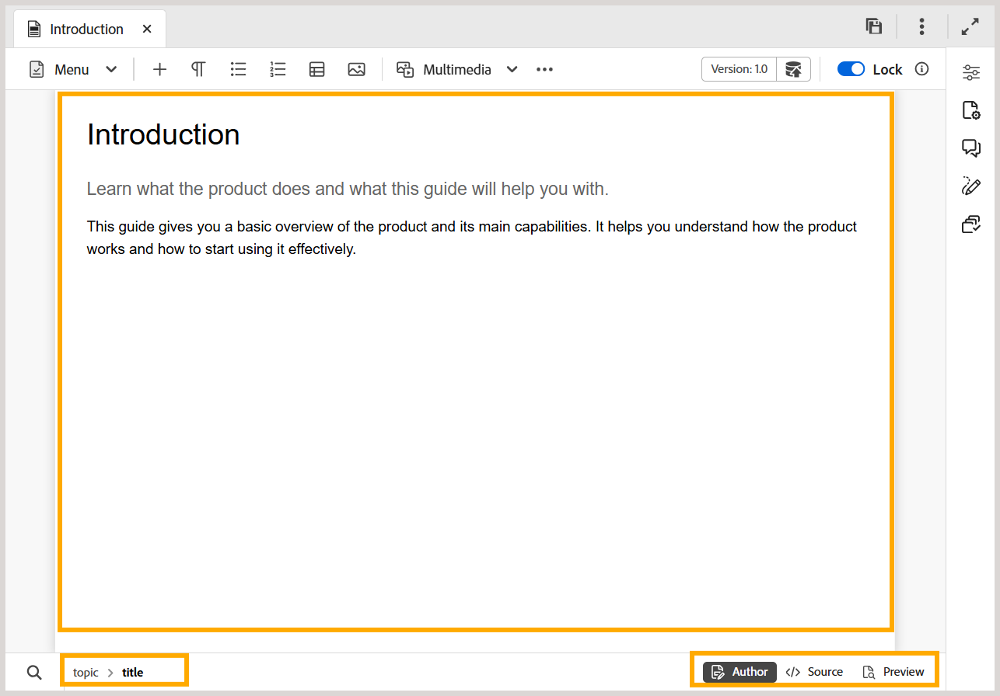

# 編輯器中的內容編輯區域

>[!INFO]
>
> 此主題適用於新編輯器和舊編輯器。 雖然核心功能保持一致，但內容會使用索引標籤和圖說文字（如適用）來指出使用者介面、術語和互動的差異。

內容編輯區域是顯示主題或地圖內容的地方。 您會在此區域中編輯所有內容。 其會提供您正在編輯內容的WYSIWYG檢視。

在內容編輯區域的左下方，您有目前游標位置處的元素階層連結。 可用的編輯器檢視會顯示在右下角。

>[!BEGINTABS]

>[!TAB 新編輯器]

>[!TAB 舊編輯器]

>[!ENDTABS]

若要進一步瞭解內容編輯區域中主題檔案可用的編輯器檢視，請檢視[編輯器檢視](./web-editor-views.md)。

>[!NOTE]
>
> 如果您正在處理對應檔案，則內容編輯區域中會顯示不同的選項或檢視。 如需詳細資訊，請檢視[對應編輯器功能](./map-editor-advanced-map-editor.md)。

**父級主題：**[&#x200B;編輯器簡介](web-editor.md)
